# Oracle APEX — Order & Inventory Management System

> A database-driven business management application developed using **Oracle APEX** and **Oracle Database**, based on the operational requirements of a medium-sized Albanian food packaging and distribution business.

**Developer:** Mateo Sheme  
**Project type:** Academic database application based on a real-world business case  
**Status:** Project documentation available; application export and database DDL to be added

## Overview

This project models the operations of **ALEGRIA**, a business that packages dried nuts and traditional Albanian products and distributes them to retail stores and supermarkets across Albania.

The goal was to design a relational database and build an Oracle APEX interface supporting the movement of orders from field sales through administrative review, warehouse preparation and delivery, while making customer, product and inventory information easier to manage.

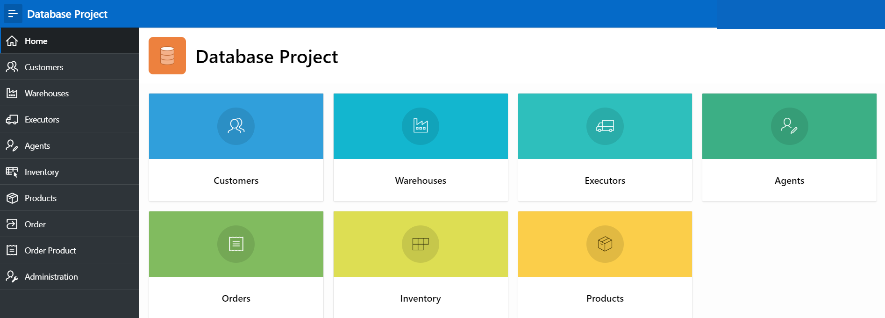

## Business workflow

1. A **sales agent** visits assigned stores and takes orders for products that need replenishment.
2. The **finance office** reviews orders, adjusts information or prices when necessary, and assigns an executor.
3. **Warehouse staff** prepare the ordered products for dispatch.
4. The **delivery executor** delivers the products and collects a cash payment or obtains a signature for non-cash payment.
5. At the end of the day, the executor returns completed order documents and collected cash.
6. The business tracks product quantities across its warehouse inventory.

This is the business workflow gathered during requirements analysis; it should not be taken as confirmation that every operational step was automated in the delivered prototype.

## Main application modules

| Module | Purpose |
| --- | --- |
| Dashboard | Navigation tiles and reporting charts |
| Customers | Create, edit and delete customer records |
| Products | Add and edit products |
| Warehouses | Maintain warehouse records |
| Inventory | Track products and quantities associated with warehouses |
| Sales agents | Maintain sales agent information |
| Executors | Maintain delivery executor information |
| Orders | Create order headers with date, customer, agent, delivery and payment status |
| Order line items | Associate products and quantities with specific orders through a database view and form |

### Dashboard and reporting

The documented reporting interface includes charts for **inventory by product**, **monthly company income**, and **customers ranked by total order value**.

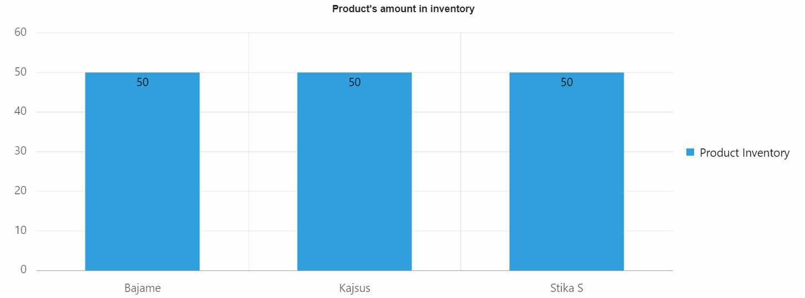
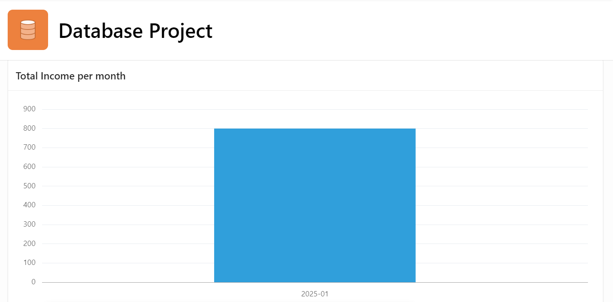

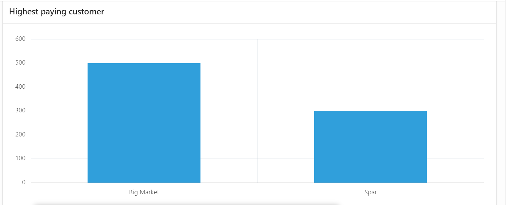

### Customer and product management

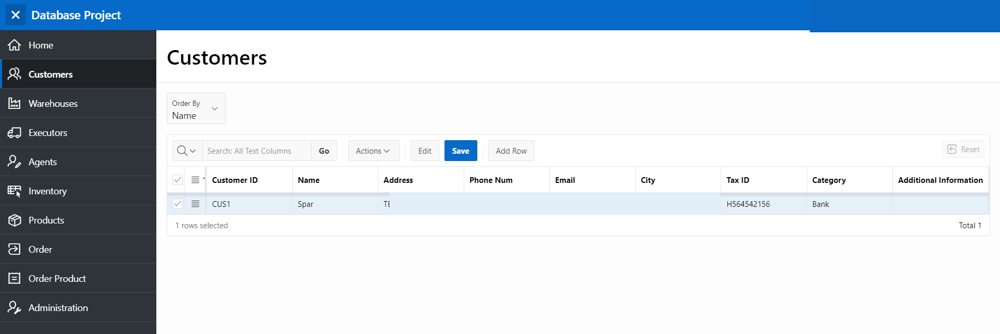
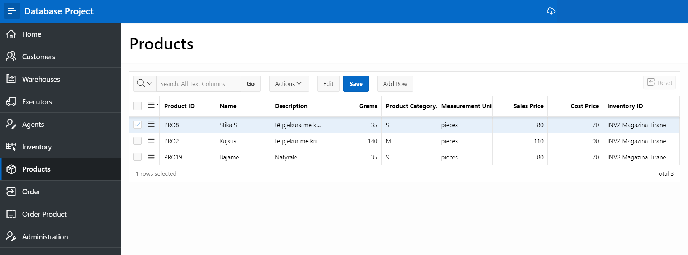

### Warehouse and inventory management

Inventory records are associated with a warehouse identifier and represent product quantities held in a specified warehouse.


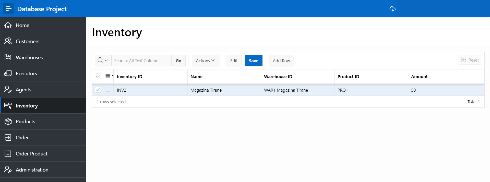

### Sales agents and executors

The application includes interfaces to maintain information about the sales agents who collect orders and the executors responsible for deliveries.

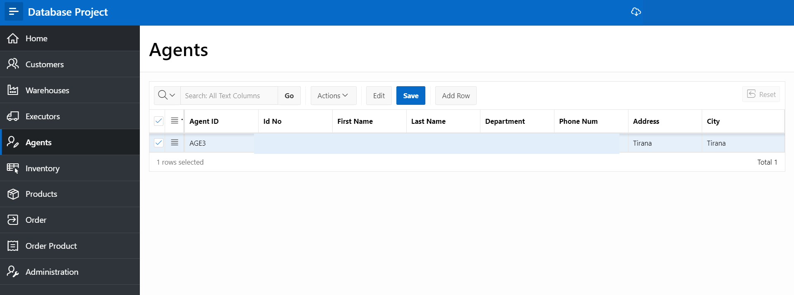
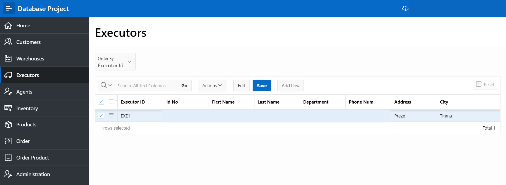

### Order management

The order header captures the date, payment status, delivery status, customer identifier and sales agent identifier. Related product entries specify which products and quantities belong to each order.

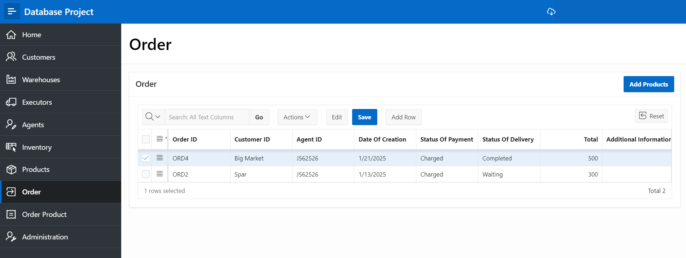
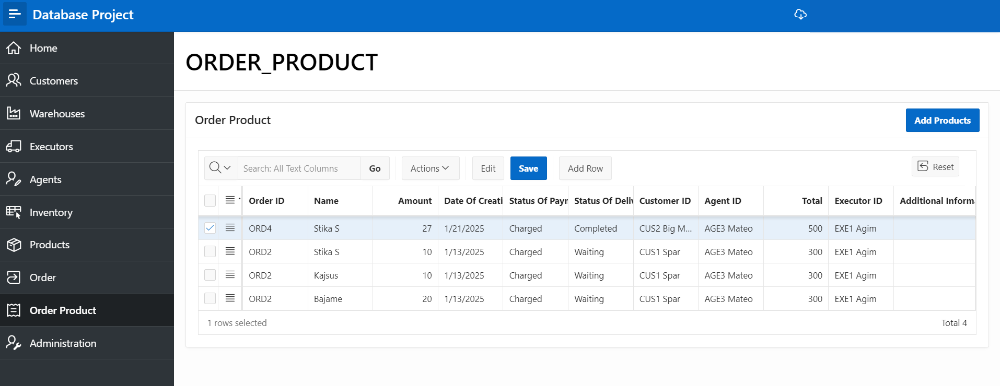
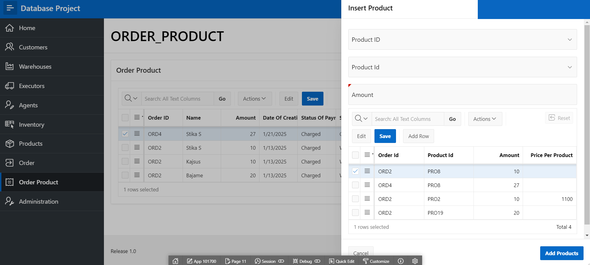

The documented prototype uses a **database view** to bring order and product information together for entry/display. The described add-product form inserts one product and its quantity at a time.

## Database design

The project uses a relational Oracle database designed around entities such as:

- Customers
- Products
- Warehouses
- Inventory
- Sales agents
- Executors
- Orders and their product line items

The original project specifies primary-key/foreign-key relationships and normalization as design requirements. The conceptual ER diagram is included below. **The actual DDL has not yet been supplied in this repository**, so the physical schema and exact constraints cannot currently be independently verified.

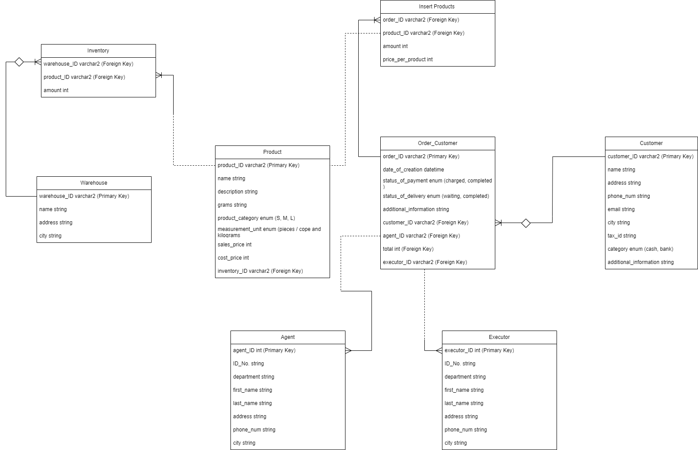

Selected table-definition screenshots illustrate the Oracle implementation:

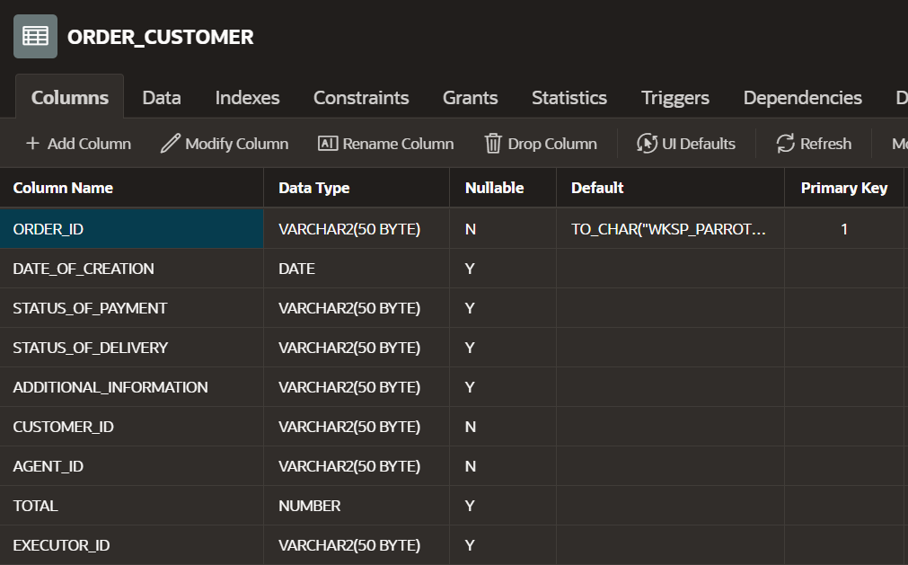
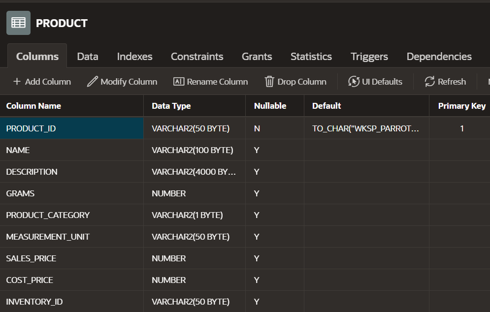

### Automatically generated identifiers

The database design describes **Oracle sequences and triggers** for generating prefixed identifiers. For example, a product identifier is formed by concatenating a prefix such as `PRO` with a sequence-generated value.

A screenshot of the `PRODUCT_NEXTVAL` sequence shows a minimum value of 1, increment of 1, and cache size 0. The original written report describes an upper sequence bound of 9999, but the screenshot shows a much larger maximum; therefore the screenshot and report differ. The SQL implementation itself should be reviewed before treating any settings as confirmed or production-ready.

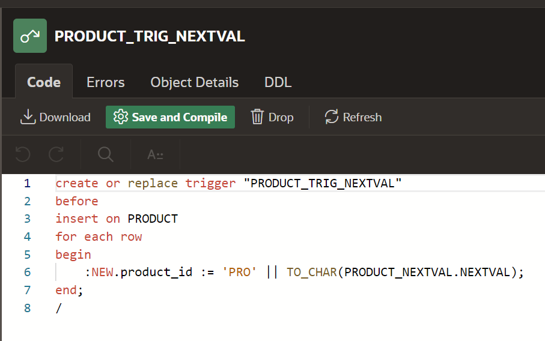
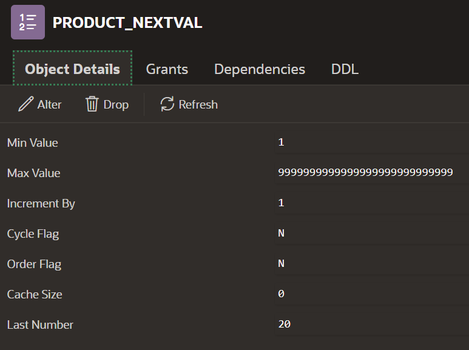

The `ORDER_PRODUCT` view screenshot shows a join between `INSERT_PRODUCTS`, `ORDER_CUSTOMER`, and `PRODUCT`:

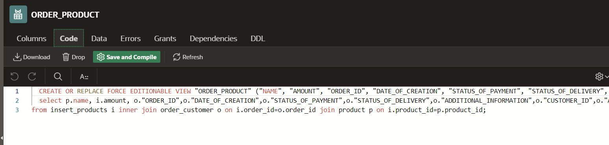

## Technology stack

- **Oracle APEX** — web application user interface, forms, navigation, charts and reports
- **Oracle Database** — relational data storage
- **SQL** — schema and query logic
- **PL/SQL** — database trigger logic

## Repository structure

```text
oracle-apex-order-inventory-management/
├── README.md
├── screenshots/
│   ├── home-dashboard.png
│   ├── inventory-by-product-chart.png
│   ├── monthly-income-chart.png
│   ├── top-customers-chart.png
│   └── ...
├── apex/                 # Add exported APEX application files here
└── database/             # Add schema, sequences, triggers and views here
```

## Installation and reproduction

> **Not yet a one-click installation:** this repository currently contains documentation and screenshots, but not the actual application export or database creation scripts.

Once those files have been added:

1. Prepare an Oracle Database and compatible Oracle APEX workspace.
2. Run the database schema scripts in dependency order, including required tables, constraints, sequences, triggers and views.
3. In APEX, use **App Builder → Import** to import the exported application.
4. Set the appropriate parsing schema and any required application settings.
5. Validate data dependencies and test the pages, forms and reports.

Do not add production credentials, secret keys or confidential customer data to this repository.

## Development challenges and learning outcomes

The main technical challenge was implementing the **one-to-many relationship between orders and ordered products**, including a quantity for each product on each order. This was addressed with a database view and the related Oracle APEX input form, with guidance from the project instructor.

The project also provided hands-on experience translating business requirements into relational data structures and developing database-backed pages in the Oracle APEX environment.

## Next improvements

- Add the actual **APEX application export** and **Oracle SQL DDL**.
- Verify the included **ER diagram** against the physical schema and exported DDL.
- Add a small set of anonymized sample data for reproducible testing.
- Document input validation, privileges and authorization rules, if implemented.
- Verify the order-line entry workflow and identifier-generation constraints against the exported SQL.
